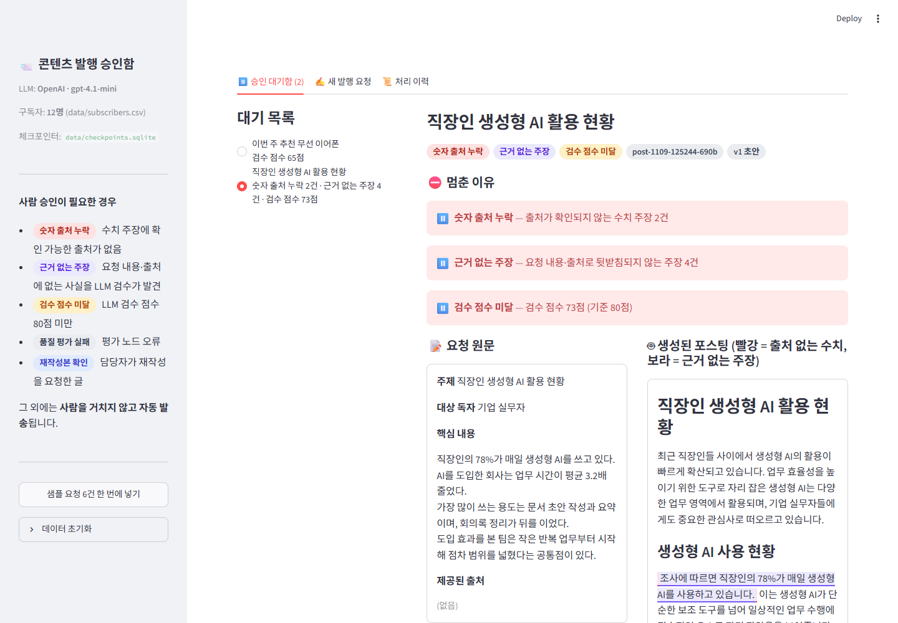

# 📨 agent-approval-system — 사람이 승인하는 콘텐츠 발행 에이전트

주제와 핵심 내용을 받으면 에이전트가 뉴스레터 글을 쓰고, **수치 출처 검사(규칙)** 와 **품질 검수(LLM Eval)** 를 거칩니다.
승인 기준에 걸리지 않은 글은 사람 없이 구독자에게 바로 발송되고, 걸린 글은 **구독자 발송 직전에 멈춰** 담당자의 승인을 기다립니다.
멈춘 글은 SQLite 체크포인터에 저장되어, 담당자가 나중에 승인·재작성 요청·반려하면 **멈춘 지점부터 이어서** 실행됩니다.

> 설계 이유, 실행 결과, 화면 설계, 회고는 [REPORT.md](REPORT.md)에 있습니다.



## 빠른 시작

**1. 설치** (Python 3.10 이상)

```bash
pip install -r requirements.txt
```

**2. API 키 설정 (선택)**

```bash
cp .env.example .env
```

`.env`에 `OPENAI_API_KEY` 또는 `GEMINI_API_KEY`를 넣습니다. 키가 없으면 **offline 모드**로 동작합니다. offline 모드는 규칙으로 초안을 만들고 LLM 평가와 같은 배점(어조 30/맥락 40/완성도 30)의 규칙으로 채점하므로, 키 없이도 자동 발송 / 승인 대기 / 재개 흐름을 모두 확인할 수 있습니다.

**3. 웹 데모 실행**

```bash
streamlit run app.py
```

브라우저에서 `http://localhost:8501`이 열립니다. 왼쪽 사이드바의 **샘플 요청 6건 한 번에 넣기**를 누르면 기준에 따라 자동 발송과 승인 대기로 나뉩니다. **⏸️ 승인 대기함** 탭에서 한 건을 열어 승인·재작성 요청·반려를 해 보세요.

**4. (선택) 터미널에서 HITL 확인** — 명령마다 프로세스가 새로 떠도 체크포인터에서 이어집니다.

```bash
python cli.py samples
```

```bash
python cli.py list
```

```bash
python cli.py approve <PENDING인 request_id> 내이름
```

`revise <id> "<피드백>"`, `reject <id> "<사유>"`도 쓸 수 있습니다.

## 사람 승인을 받는 기준

하나라도 걸리면 `human_review`에서 멈춥니다 (`criteria.py`).

| 기준 | 계산 방법 |
|---|---|
| 숫자 출처 누락 (규칙) | `숫자+단위` 수치 주장이 있는 문장에 인용 `[n]`이 없거나, 참고자료에 없는 번호이거나, 요청에서 받지 않은 URL을 출처로 단 경우 1건 이상 |
| 근거 없는 주장 (LLM) | 평가 노드가 요청에 없는 내용을 문장별로 `evidence`(조사·전문가·평가 사칭) / `specific`(구체적 사실 단정) / `general`(일반 설명)로 분류. `evidence`+`specific` 1건 이상 |
| 검수 점수 미달 (LLM) | 어조 30 + 맥락 40 + 완성도 30 = 100점 중 80점 미만 (`QUALITY_THRESHOLD`로 조정) |
| 품질 평가 실패 | 평가 노드 예외·파싱 실패 (fail-closed) |
| 재작성본 확인 | 담당자가 재작성을 요청한 글은 재검사를 통과해도 담당자에게 되돌림 |

## 파일 구조

| 파일 | 역할 |
|---|---|
| `graph.py` | LangGraph 파이프라인, `interrupt()` 기반 `human_review`, SqliteSaver 체크포인터, 발송(outbox) |
| `criteria.py` | 승인 기준 (수치 출처 규칙, 근거 없는 주장·점수 기준, offline 채점, 게이트) |
| `service.py` | 작업 API: 제출 / 재개 / 조회 / 목록 (앱과 CLI 공용) |
| `app.py` | Streamlit 승인함 데모 |
| `cli.py` | 터미널에서 HITL 흐름 확인 |
| `llm.py` | OpenAI / Gemini / offline 선택 |
| `samples.py` | 데모 요청 6건 (예시 도메인과 가상 수치) |
| `data/subscribers.csv` | 예시 구독자 12명 |
| `docs/screenshots/` | REPORT.md에 쓴 화면 캡처 |

실행하면 `data/checkpoints.sqlite`(대기 중인 작업)와 `outbox/`(발송본과 `send_log.jsonl`)가 생깁니다. 데모에서 "발송"은 실제 메일 대신 `outbox/`에 기록합니다. 둘 다 `.gitignore`에 들어 있습니다.

## API 키 보안

- `.env`는 `.gitignore`에 있어 저장소에 올라가지 않습니다. `.env.example`에는 키를 넣지 마세요.
- Streamlit Community Cloud 등에 배포할 때는 키를 코드에 넣지 말고 배포 서비스의 **Secrets**에 `OPENAI_API_KEY = "..."` 형태로 넣습니다. 최상위 Secrets는 환경 변수로 노출되어 `llm.py`가 그대로 읽습니다.
