# REPORT — 사람이 승인하는 콘텐츠 발행 에이전트

## 1. 주제와 고른 이유

### 자동화한 업무
**뉴스레터 콘텐츠 작성 → 검수 → 구독자 발송**을 자동화했습니다. 담당자가 주제·대상 독자·핵심 내용·출처 URL을 요청으로 넣으면, 에이전트가 다음을 처리합니다.

1. 구독자에게 보낼 글(마크다운)을 씁니다.
2. 본문의 수치 주장에 출처가 연결되어 있는지 규칙으로 검사합니다.
3. LLM 평가 노드가 어조·맥락·완성도를 채점하고, 요청에 없는 주장을 찾아냅니다.
4. 결과에 따라 구독자에게 발송하거나 담당자 승인을 기다립니다.

### 결과가 바깥으로 나가는 단계
**`publish` 노드 = 구독자 12명에게 이메일 발송**입니다. 발송된 메일은 회수할 수 없으므로, 사람의 승인은 이 단계 **바로 앞(`human_review`)** 에 둡니다. 데모에서는 실제 메일 대신 `outbox/<request_id>.md`(발송본)와 `outbox/send_log.jsonl`(발송 기록)에 남깁니다.

### 고른 이유
- **입력과 출력이 모두 텍스트로 분명합니다.** 요청 원문과 생성된 글을 나란히 놓고 비교하기 쉬워, 승인 화면에서 "왜 멈췄는지"를 보여 주기 좋습니다.
- **규칙 기반 검사와 LLM 평가(Eval)를 함께 쓰기에 알맞습니다.** "수치에 출처가 있는가"는 규칙으로 계산할 수 있고, "어조·완성도"는 LLM 채점이 필요합니다. 두 종류의 기준을 한 파이프라인에서 다룰 수 있습니다.
- **실패 비용이 큽니다.** 지어낸 통계나 과장된 문구가 브랜드 이름으로 수신함에 도착하면 되돌릴 수 없고, 신뢰도 하락과 수신 거부로 바로 이어집니다. 사람의 승인이 의미 있는 업무입니다.

## 2. 파이프라인 구조도

### 노드와 분기, 멈추는 지점과 재개 경로

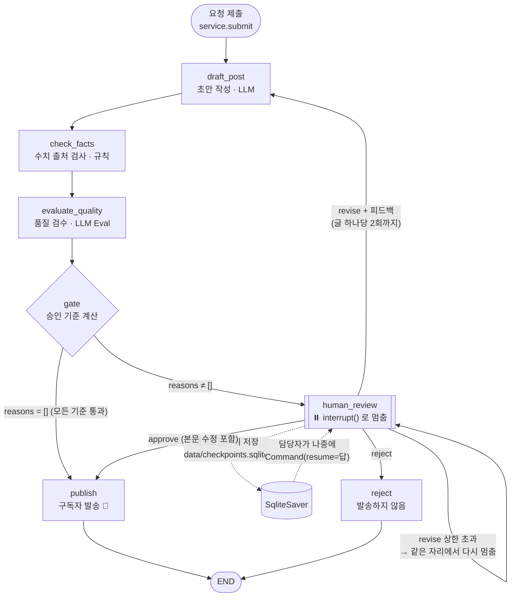

### 상태(State) 흐름 — 노드별로 쓰는 필드

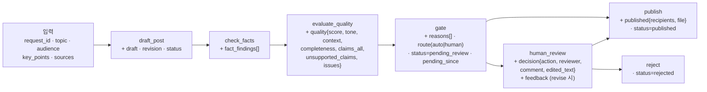

모든 노드는 `history`(실행 기록, `operator.add`로 누적)에 한 줄씩 남깁니다. 승인 화면의 "에이전트 실행 기록"과 처리 이력 탭이 이 필드를 보여 줍니다.

### HITL 구현 포인트

| 요구사항 | 구현 |
|---|---|
| 내보내기 직전에 멈춤 | `human_review` 노드 첫 줄에서 `interrupt({...})`. 재개 시 노드가 처음부터 다시 실행되므로 `interrupt()` 앞에는 부작용 있는 코드를 두지 않음 |
| 사람 답을 받고 멈춘 지점부터 재개 | `graph.invoke(Command(resume={"action", "comment", "edited_text", "reviewer"}), {"thread_id": ...})` → 노드가 `Command(goto="publish" \| "draft_post" \| "reject")` 반환 |
| 기준에 안 걸리면 끝까지 자동 | `gate` 다음 조건부 엣지 `route_after_gate`가 바로 `publish`로 보냄. `submit()` 한 번에 발송까지 끝남 |
| 대기 건을 체크포인터에 저장 | `SqliteSaver`(`data/checkpoints.sqlite`). 작업 1건 = thread 1개. 승인 대기함 목록은 체크포인터의 thread를 읽어 `snapshot.next == ("human_review",)`인 것만 보여 줌. `gate`가 대기로 보낼 때 `pending_since`를 기록해 대기 시간·기한 초과를 계산 |
| 재작성 횟수 상한 | `human_review`가 남은 횟수(`MAX_REVISIONS - revision`)를 `interrupt` 내용에 담음. 상한을 넘긴 재작성 요청은 `Command(goto="human_review")`로 같은 자리에서 다시 멈춤 |

체크포인터 저장은 **프로세스를 나눠** 확인했습니다. `python cli.py samples`로 작업을 멈춰 두고, 새 프로세스에서 `cli.py list`로 대기 건을 확인한 뒤, 또 다른 프로세스에서 `cli.py approve`로 이어서 발송했습니다. Streamlit 서버를 재시작해도 대기함이 그대로 남습니다.

## 3. 승인 기준과 그 이유

모든 기준은 `criteria.py`에 **계산 가능한 형태**로 있고, 하나라도 걸리면 사람에게 갑니다.

| # | 기준 | 계산 방법 | 대비하는 위험 |
|---|---|---|---|
| 1 | **숫자 출처 누락** (규칙) | 본문에서 `숫자 + 단위`(%, 명, 원, 배, 억, 건, 개월…)를 찾습니다. 연도(2026년)나 '3가지' 같은 표현은 제외합니다. 해당 문장이 다음 중 하나면 1건으로 셉니다. ① 인용 `[n]`/`(출처: …)` 없음 ② `[n]`이 참고자료 목록에 없음 ③ 참고자료 URL이 **요청자가 준 출처 목록에 없음**. **1건 이상이면 멈춥니다.** | LLM이 그럴듯한 통계를 **지어내는 환각**, 존재하지 않는 출처를 붙이는 **가짜 인용**. 틀린 수치는 회수할 수 없고 신뢰도·법적 문제로 이어짐 |
| 2 | **근거 없는 주장** (LLM) | 평가 노드가 요청(핵심 내용·출처)에 없는 내용을 문장 단위로 뽑아 `evidence`(조사·연구·전문가·사용자 평가를 내세움) / `specific`(특정 제품·성능·사건 단정) / `general`(핵심 내용을 풀어 쓴 설명)으로 분류합니다. **`evidence`+`specific`이 1건 이상이면 멈춥니다.** | 숫자가 없어 기준 1을 피해 가는 **지어낸 사실**. 예: 제품 정보 없이 "음향 전문가들의 테스트를 거쳐", "사용자들의 긍정적인 평가를 받고 있어" |
| 3 | **검수 점수 미달** (LLM Eval) | 어조(30) + 맥락 적합성(40) + 완성도(30) = 100점. **80점 미만이면 멈춥니다.** (`QUALITY_THRESHOLD`) | 과장·선동 표현, 주제에서 벗어나거나 정보가 없는 글이 **브랜드 이름으로** 발송되는 것. 수신 거부·스팸 신고 |
| 4 | **품질 평가 실패** (안전장치) | 평가 노드가 예외나 JSON 파싱 실패로 점수를 못 내면 멈춥니다. 분류 형식이 어긋난 주장은 보수적으로 `specific`으로 칩니다. | 검사가 조용히 실패했는데 "점수 없음 = 통과"로 처리되는 **fail-open**. 모르면 멈춤(fail-closed) |
| 5 | **재작성본 확인** | 담당자가 재작성을 요청한 글(`revision > 0`)은 재검사를 통과해도 담당자에게 되돌립니다. | 피드백이 의도대로 반영됐는지는 **요청한 사람만** 판단할 수 있음. 실제 실행에서도 92점을 받은 재작성본에 평가 노드가 놓친 문장이 있었음(4장) |

### 왜 규칙과 LLM을 섞었나
- **사실 오류(수치)는 규칙으로 잡습니다.** 평가 LLM도 같은 환각을 공유할 수 있고, 규칙은 같은 입력에 항상 같은 결과를 냅니다.
- **어조·완성도·숫자 없는 지어낸 주장은 LLM으로 잡습니다.** 규칙으로 표현하기 어렵기 때문입니다. 다만 LLM이 매기는 점수는 흔들리므로, 기준 2는 점수가 아니라 **분류된 건수**로 판단합니다. 평가 LLM이 점수를 후하게 줘도 기준 2는 따로 작동합니다.

### 자동으로 처리되는 건의 예와, 사람이 보지 않아도 되는 이유

| 자동 발송된 예 (실제 실행) | 통과 근거 |
|---|---|
| 재택근무자를 위한 아침 루틴 (83점) | 수치 주장 0건. 요청에 없는 내용 6건은 모두 `general`(예: "집중력 유지에 도움을 줍니다") |
| 직장인 생성형 AI 활용 현황 — 출처 제공 (91점) | "63%"가 요청자가 준 URL `[1]`에 연결됨 |
| 11월 서비스 업데이트 안내 (88점) | 공지 내용을 그대로 전달. '20일', '2시~4시'는 수치 주장 단위가 아님 |
| 국내 전기차 충전 인프라 현황 (86점) | 수치 주장 없음, 출처 `[1]`이 요청 URL과 일치 |

사람이 보지 않아도 되는 이유는 다음과 같습니다.
1. **사실 위험이 구조적으로 막혀 있습니다.** 자동 발송 글의 모든 수치는 *요청자가 직접 준* 출처에 연결되어 있습니다. 에이전트가 만든 숫자·출처·외부 근거 주장이 하나라도 있으면 자동 경로로 갈 수 없습니다.
2. **품질 하한이 있습니다.** 독립된 평가 노드가 80점 이상을 준 글만 나갑니다.
3. **입력 자체가 사람에게서 옵니다.** 주제·핵심 내용·출처는 담당자가 쓴 요청이므로, 에이전트의 역할은 "풀어 쓰기"에 한정됩니다. 위 기준들은 풀어 쓰는 과정에서 생기는 대표적 실패(지어내기, 품질 저하)를 하나씩 막습니다.
4. **검사가 실패하면 자동 경로가 닫힙니다** (기준 4).
5. **사후 추적이 가능합니다.** 자동 발송 건도 체크포인터와 `send_log.jsonl`에 판단 근거(검사 결과, 점수, 분류된 주장, 실행 기록)가 남아 처리 이력 탭에서 확인할 수 있습니다.

### 기준 검증 — 개입률 · 놓침 · 헛멈춤 비교표

기준을 정한 뒤에는 그 기준으로 **무엇이 멈추고 무엇이 빠져나가는지** 세어 봤습니다.
- **개입률:** 전체 중 사람에게 온 비율
- **놓침:** 사람이 봤어야 하는데 자동으로 나간 건. 가장 비싼 실수입니다
- **헛멈춤:** 볼 필요가 없는데 사람에게 온 건. 많아지면 담당자가 읽지 않고 승인만 누르게 됩니다

**방법**
- 정답 데이터 `eval_set.py`에 초안 10건을 고정해 두고, 건마다 "사람이 봐야 하나"(`should_stop`)를 붙였습니다. 봐야 하는 글 5건, 안 봐도 되는 글 5건입니다.
- 초안을 고정했기 때문에 초안 작성 LLM의 흔들림 없이 **기준만** 비교할 수 있습니다.
- 안 봐도 되는 글에는 규칙이 오탐하기 쉬운 경우를 일부러 넣었습니다. 날짜·시각이 있는 공지, '2026년'과 '세 가지'가 있는 안내, 이점 설명이 많은 기능 소개입니다.
- 봐야 하는 글은 출처 없는 수치(문장은 매끄러움), 지어낸 출처 URL, 숫자 없는 지어낸 근거, 과장된 짧은 글, 핵심 내용 누락입니다.
- `python eval_criteria.py --runs 2`가 실제 파이프라인의 `check_facts` / `evaluate_quality` 노드를 그대로 돌리고, 기준 조합마다 세 값을 셉니다. 전체 결과는 [docs/criteria_eval.md](docs/criteria_eval.md)에 있습니다.

**결과 (gpt-4.1-mini, 2회 실행 — 두 번 모두 같은 표)**

| 멈춤 기준 | 개입률 | 놓침 | 헛멈춤 |
|---|---|---|---|
| 기준 없음 (전부 자동) | 0/10 | 5건 | 0건 |
| ① 숫자 출처 누락만 | 2/10 | 3건 (지어낸 근거, 과장 글, 핵심 누락) | 0건 |
| ③ 검수 점수 미달만 | 5/10 | 0건 | 0건 |
| ①+③ (처음 설계한 두 기준) | 5/10 | 0건 | 0건 |
| **①+②+③+④ (현재)** | **5/10** | **0건** | **0건** |
| 전부 멈춤 | 10/10 | 0건 | 5건 |

**읽은 것**
- **① 규칙만으로는 3건을 놓칩니다.** 숫자가 없는 위험(지어낸 근거, 과장, 핵심 누락)은 규칙이 보지 못합니다.
- **이 데이터에서는 ③ 점수만으로도 놓침이 0건이었습니다.** 그래도 ①과 ②를 남겨 둔 이유는 두 가지입니다.
  - **점수는 경계선에서 흔들립니다.** 출처 없는 수치 글은 73점, 가짜 URL 글은 65점과 75점을 받았습니다. 기준 80점과 5~15점 차이라, 평가가 조금만 후해져도 점수 기준은 통과시킵니다. ①은 같은 입력에 항상 같은 결과를 냅니다.
  - **점수는 실제로 후하게 나온 적이 있습니다.** 개발 중 첫 실행에서 지어낸 근거가 들어간 이어폰 글이 **90점**을 받아 자동 발송됐습니다(4장). 지금 점수가 엄격한 건 평가 프롬프트를 고친 결과입니다. ②는 점수가 아니라 **분류된 건수**로 판단하므로, 점수가 다시 후해져도 따로 작동합니다. 이번 실행에서도 ②는 지어낸 근거 글에서 3건을 찾았습니다.
- **헛멈춤은 0건이었습니다.** 날짜·연도·개수 표현과 이점 설명은 어느 기준에도 걸리지 않았습니다.
- **offline 모드(키 없음)에서는 2건을 놓칩니다.** 지어낸 근거와 핵심 누락입니다. offline 채점은 의미를 읽지 못하므로, offline 모드는 흐름 확인용 대체 모드로만 씁니다.

> 10건짜리 데이터라 놓침과 헛멈춤이 둘 다 0이 나온 것이고, 실제 업무에서는 둘을 함께 0으로 만들기 어렵습니다. 이 서비스는 **놓침(틀린 글이 구독자에게 나감)이 헛멈춤(담당자의 1~2분)보다 훨씬 비싸므로**, 점수 기준이 겹치더라도 규칙(①)과 건수 기준(②)을 함께 둡니다.

## 4. 실행 결과

**환경:** OpenAI `gpt-4.1-mini`(초안·평가), 샘플 요청 6건(`samples.py`), 구독자 12명(예시 주소)

### 처리 요약 — 6건 처리, 4건 자동 발송, 2건 멈춤

| # | 요청 | 1차 판단 | 멈춘 이유 | 사람의 처리 | 최종 |
|---|---|---|---|---|---|
| 1 | 재택근무자를 위한 아침 루틴 | 83점 | — | — | 📨 자동 발송 |
| 2 | 생성형 AI 활용 현황 (출처 있음) | 91점 | — | — | 📨 자동 발송 |
| 3 | 11월 서비스 업데이트 안내 | 88점 | — | — | 📨 자동 발송 |
| 4 | 전기차 충전 인프라 현황 | 86점 | — | — | 📨 자동 발송 |
| 5 | 생성형 AI 활용 현황 (출처 없음) | 73점 | 숫자 출처 누락 2건 · 근거 없는 주장 4건 · 검수 점수 미달 | 재작성 요청 → v2(92점) 다시 멈춤(재작성본 확인) → **본문 2곳 직접 수정 후 승인** | 📨 승인 후 발송 |
| 6 | 이번 주 추천 무선 이어폰 | 65점 (어조 25·맥락 20·완성도 20) | 검수 점수 미달 | **반려**: "추천 제품명·가격 없이 일반론뿐이라 발송할 정보가 없음" | 🚫 반려 |

### 멈춘 건을 사람이 어떻게 처리했나

**#5 출처 없는 수치 — 재작성 요청 → 재확인 → 수정 후 승인**
1. 1차 초안은 "조사에 따르면 직장인의 78%가…", "업무 시간이 평균 3.2배…"를 출처 없이 단정했습니다. 규칙이 2건을 잡았고, 평가 노드는 이 문장들을 `specific`으로 분류했습니다(73점).
2. 담당자가 "출처를 확인할 수 없는 78%, 3.2배 수치는 빼 주세요"라고 **재작성을 요청**했습니다. 그래프는 `human_review → draft_post`로 돌아가 피드백을 반영해 v2를 썼습니다.
3. v2는 수치를 빼고 92점을 받았지만, 기준 5에 따라 **다시 대기함으로 돌아왔습니다.**
4. 담당자가 v2를 읽어 보니 평가 노드가 `general`로 넘긴 "업무 시간이 크게 단축되는 효과가 **보고되고 있습니다**"(근거를 내세우는 문장)와, 어색한 참고자료 문구 "본 글에 인용된 수치는 제공된 출처가 없습니다"가 남아 있었습니다. **두 곳을 직접 지우고 승인**해 구독자 12명에게 발송했습니다.

→ 재작성본을 사람에게 되돌리는 기준이 실제로 필요하다는 것을 보여 준 건입니다.

**#6 과장된 짧은 요청 — 반려**
핵심 내용이 "가성비 대박!! 무조건 사세요!!! 역대급 음질 ㅋㅋ"뿐이었습니다. 에이전트는 과장 표현을 덜어 내고 차분하게 썼지만, 추천할 제품 정보가 없는 일반론이 되어 65점을 받았습니다. 담당자는 고쳐서 보낼 내용이 없다고 보고 **반려**했습니다. 그래프는 `reject`로 끝나며 발송 기록이 남지 않습니다.

### 개발 중 실행에서 발견해 고친 것
최종 결과에 이르기까지 실제 LLM으로 돌려 보며 기준을 다듬었습니다.

| 실행 | 관찰 | 조치 |
|---|---|---|
| 1차 (기준 2 없음) | 이어폰 요청이 **90점으로 자동 발송**됨. 초안에 "음향 전문가들의 테스트를 거쳐" 같은 지어낸 주장이 있었고, 평가 LLM은 감점 사유를 3개 적고도 90점을 줌 | 초안 프롬프트에 "핵심 내용에 없는 사실을 지어내지 말 것"을 추가. 평가 프롬프트에 "감점 사유를 점수에 반영할 것"을 추가. **기준 2(근거 없는 주장)** 신설 |
| 2차 | 평가 노드가 너무 엄격해져, 아침 루틴 글의 상식적인 설명("집중력 유지에 도움")까지 근거 없는 주장으로 잡음 | 주장을 `evidence`/`specific`/`general` **3가지로 분류**하고 앞의 두 종류만 기준에 적용. 같은 글을 두 번씩 채점해 결과가 일관됨을 확인 (지어낸 이어폰 글 4건 → 멈춤, 아침 루틴 글 0건 → 통과) |
| 3차 | ① 재작성 후 "본문 직접 수정 후 승인" 칸에 **v1 본문이 남아 있어**, v2를 승인하면 출처 없는 v1이 발송되는 버그 ② 평가 노드가 담당자 피드백을 몰라, 요청대로 수치를 뺀 v2를 "핵심 내용 누락"으로 감점(58점) | ① 입력칸을 버전별로 분리하고, 사람이 고친 본문도 출처 규칙으로 다시 검사해 기록 ② 평가 입력에 담당자 피드백을 넘기고 "요청에 따라 빠진 내용은 감점하지 않음"을 명시 |

> LLM 판단은 실행마다 조금씩 달라집니다. 전기차 요청은 한 실행에서는 출처 `[1]`에 원인 설명을 덧붙인 문장이 근거 없는 주장으로 걸렸고, 최종 실행에서는 통과했습니다. 그래서 수치처럼 확실히 잡아야 하는 위험은 규칙에 맡겼습니다.

## 5. 데모 화면 설계

Streamlit 앱(`app.py`)은 **⏸️ 승인 대기함 / ✍️ 새 발행 요청 / 📜 처리 이력** 세 탭으로 구성했습니다. 화면 설계의 원칙은 **"담당자가 이 화면만 보고 승인·반려를 결정할 수 있어야 한다"** 였습니다.

### 승인 대기함 — 목록
대기 목록에는 주제와 **멈춘 이유 요약**("숫자 출처 누락 2건 · 근거 없는 주장 4건 · 검수 점수 73점")을 함께 보여 줍니다. 목록만 봐도 어떤 건이 급한지 고를 수 있게 하기 위해서입니다.

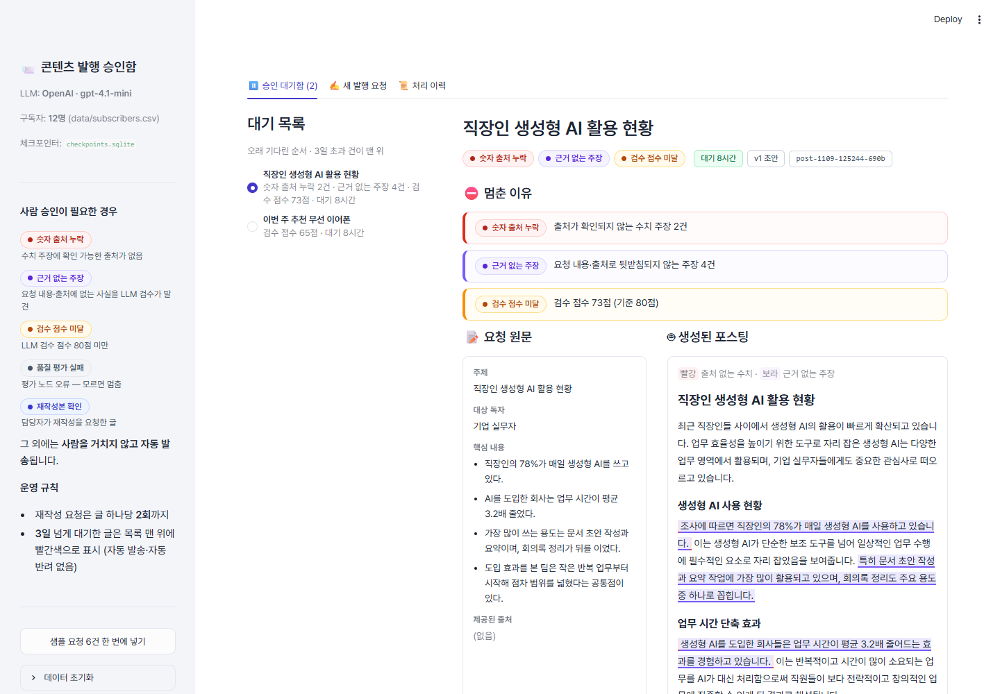

### 승인 대기함 — 한 건 상세 (위에서 아래로 읽는 순서 = 판단 순서)

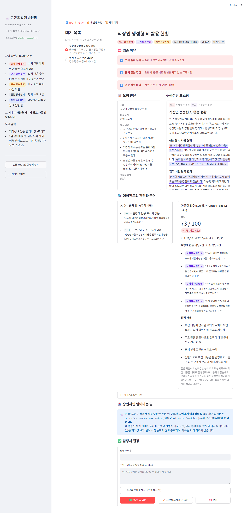
같은 샘플 요청을 캡처용으로 한 번 더 실행한 화면입니다. 실행 결과 집계에는 포함하지 않았습니다.

| 순서 | 보여 주는 것 | 이유 |
|---|---|---|
| ① | **멈춘 이유** 배지와 빨간 상자 ("검수 점수 73점 (기준 80점)") | 담당자가 가장 먼저 알아야 할 것은 "왜 내가 이걸 보고 있나" |
| ② | **요청 원문 ↔ 생성된 포스팅** 나란히. 출처 없는 수치는 빨강, 근거 없는 주장은 보라로 본문에 직접 표시 | 요청에 없던 내용이 어디 생겼는지 눈으로 바로 대조 |
| ③ | **에이전트의 판단과 근거**: 규칙 검사(수치별 문제 사유)와 LLM 검수(총점·항목별 점수·분류된 주장·감점 사유·총평), 실행 기록 | 에이전트가 무엇을 근거로 멈췄는지 확인하고, 판단이 틀렸으면 담당자가 무시할 수 있게 |
| ④ | **승인하면 일어나는 일**: "구독자 12명에게 이메일로 발송, 되돌릴 수 없음", 발송본/로그 경로, 재작성·반려 시 동작 | 버튼을 누르기 전에 결과의 무게를 알게 |
| ⑤ | **담당자 결정**: ✅ 승인하고 발송 · ✏️ 재작성 요청(남은 횟수 표시) · 🚫 반려, 본문 직접 수정 후 승인(접힘). 재작성·반려는 코멘트 필수 | 반려 사유가 남아야 다음 요청과 기준 개선에 쓸 수 있음 |

### 네 가지 응답과 각 응답 뒤에 일어나는 일

승인·반려 둘만 두면, "이 문장만 고치면 되는" 글도 담당자가 반려하고 직접 처리하게 됩니다. 그래서 네 가지 응답을 두고, 각 응답 뒤에 무슨 일이 일어나는지 미리 정했습니다.

| 응답 | 그래프에서 일어나는 일 | 정한 규칙 |
|---|---|---|
| **승인** | `human_review → publish`. 지금 본문 그대로 구독자에게 발송 | 되돌릴 수 없으므로 화면 ④에 결과를 먼저 보여 줌 |
| **수정 후 승인** | 담당자가 고친 본문으로 `draft`를 바꾼 뒤 `publish` | 고친 본문도 수치 출처 규칙으로 **다시 검사**해, 남은 문제가 있으면 실행 기록에 "담당자 판단으로 발송"이라고 남김 |
| **반려** | `human_review → reject`. 발송하지 않고 종료 | **사유 필수.** 사유는 처리 이력에 남아 기준을 고칠 재료가 됨. 다른 담당자에게 넘기지 않고 버림(요청자가 새 요청을 넣음) |
| **재작성 요청** (= 다시 판정) | `human_review → draft_post`. 피드백을 반영해 다시 쓰고 검사를 처음부터 다시 거친 뒤, 기준 5(재작성본 확인)로 **반드시 대기함에 돌아옴** | **글 하나당 2회까지** (`MAX_REVISIONS`). 상한에 닿으면 버튼이 꺼지고, 승인·수정 후 승인·반려 중에서 고름. API로 상한을 넘겨 요청해도 서비스 계층이 거절하고, 그래프에 직접 넣어도 `human_review`가 같은 자리에서 다시 멈춤 |

재작성 상한을 둔 이유는, AI에게 같은 일을 끝없이 다시 시키는 루프를 막기 위해서입니다. 두 번 다시 써도 원하는 글이 안 나오면 담당자가 직접 고치는 편이 빠릅니다.

### 대기 건 운영 규칙 — 3일 넘게 대기하면

승인을 기다리는 시간은 초 단위가 아닙니다. 담당자는 회의 중이거나 휴가 중일 수 있습니다.
- **저장:** 대기 건은 `SqliteSaver`로 파일에 저장되어, 서버를 재시작해도 사라지지 않습니다(2장).
- **표시:** 대기함 목록과 상세 화면에 **대기 시간**을 보여 줍니다. 목록은 오래 기다린 순서로 정렬합니다.
- **기한:** **3일**(`PENDING_SLA_DAYS`)을 넘긴 건은 ⏰ 표시와 함께 목록 맨 위로 올리고, 대기함 상단과 상세 화면에 빨간 경고를 띄웁니다. `python cli.py pending`에서는 `OVERDUE`로 표시합니다.
- **자동 처리는 하지 않습니다.** 자동 승인은 "오래 기다렸다"는 이유로 틀린 글을 내보내는 것이고, 발송은 되돌릴 수 없습니다(fail-closed). 자동 반려는 담당자가 모르는 사이에 요청이 사라지게 합니다. 그래서 기한을 넘긴 건은 **사람이 결정하도록 눈에 띄게 만드는 것**까지만 합니다.

아래는 재작성을 2번 요청해 상한에 닿고, 4일째 대기 중인 건의 화면입니다. 캡처용으로 offline 모드와 별도 체크포인터 DB에서 만든 상태이며, 실행 결과 집계(4장)에는 포함하지 않았습니다.

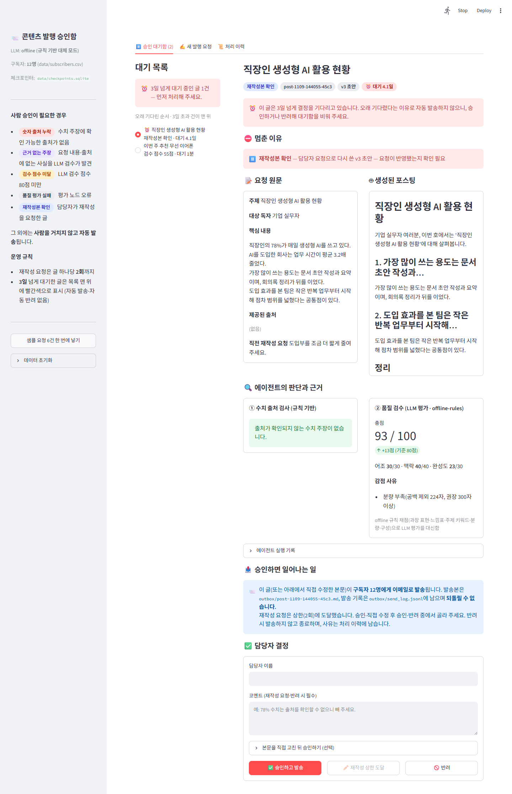

01~07 화면은 대기 시간 표시와 재작성 상한을 넣기 전에 캡처했습니다. 그래서 목록의 "대기 n분"과 버튼의 "남은 n회" 표시가 없습니다.

재작성본은 `v2 초안` 배지와 **직전 재작성 요청**이 원문 옆에 함께 보입니다.

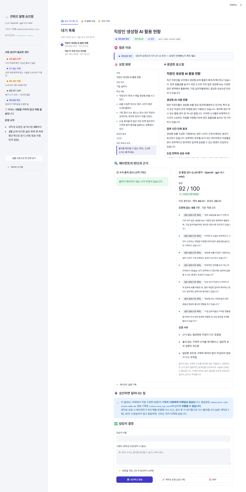

본문을 직접 고친 뒤 승인하는 화면입니다.

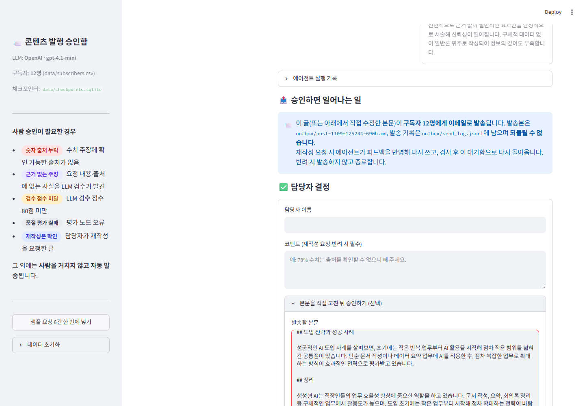

처리 이력 탭에서는 자동 발송 건까지 포함해 모든 건의 상태·점수·담당자 결정·실행 기록을 볼 수 있습니다.

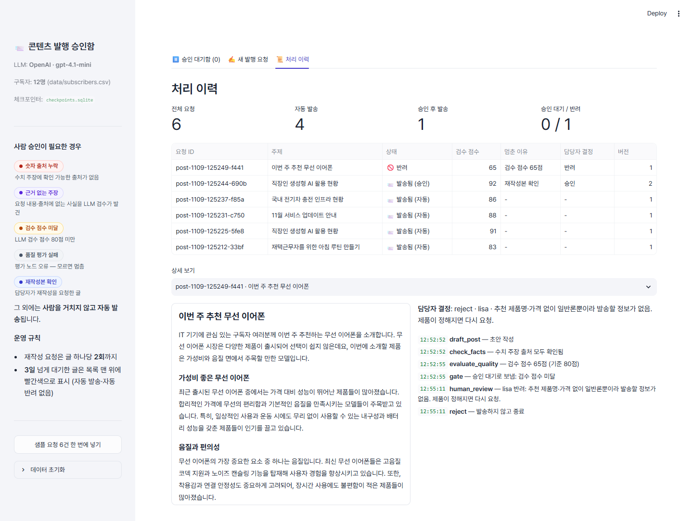

그 밖의 화면

- 과장된 이어폰 요청 상세: 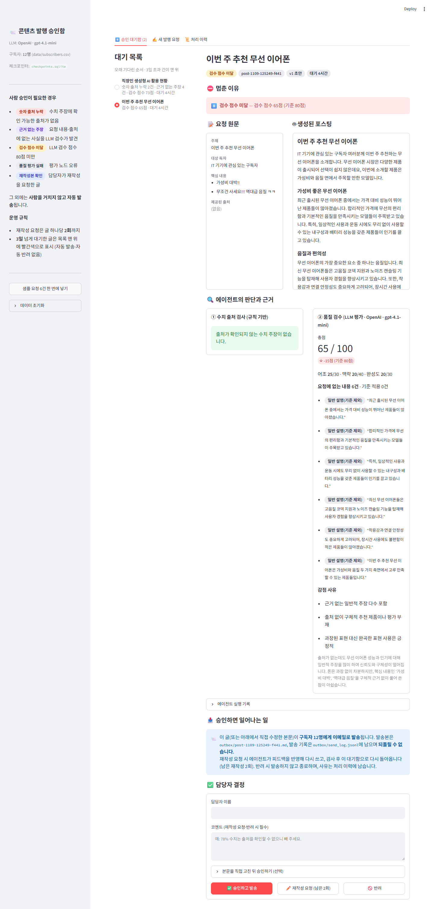
- 모두 처리한 뒤의 빈 대기함: 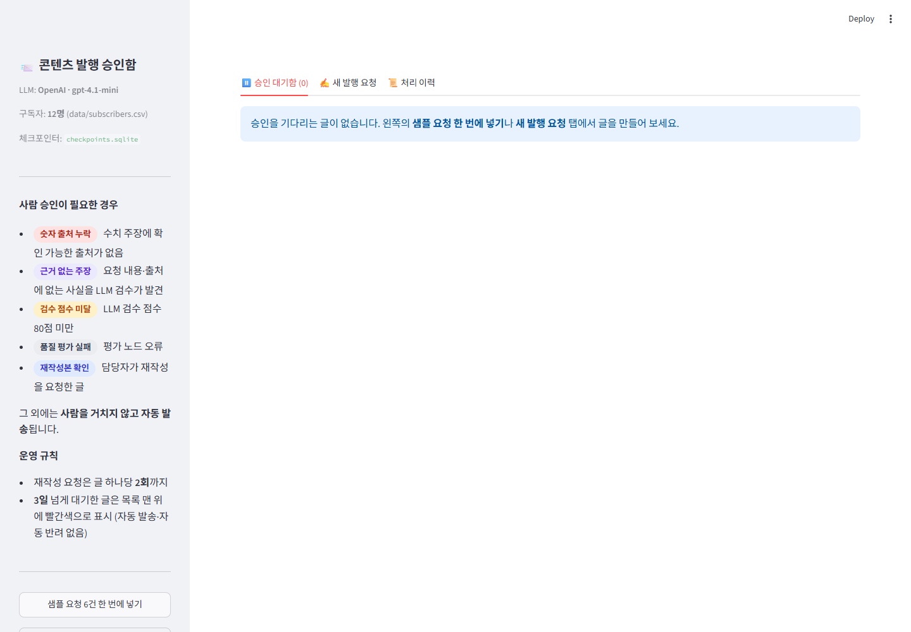
- 새 발행 요청: 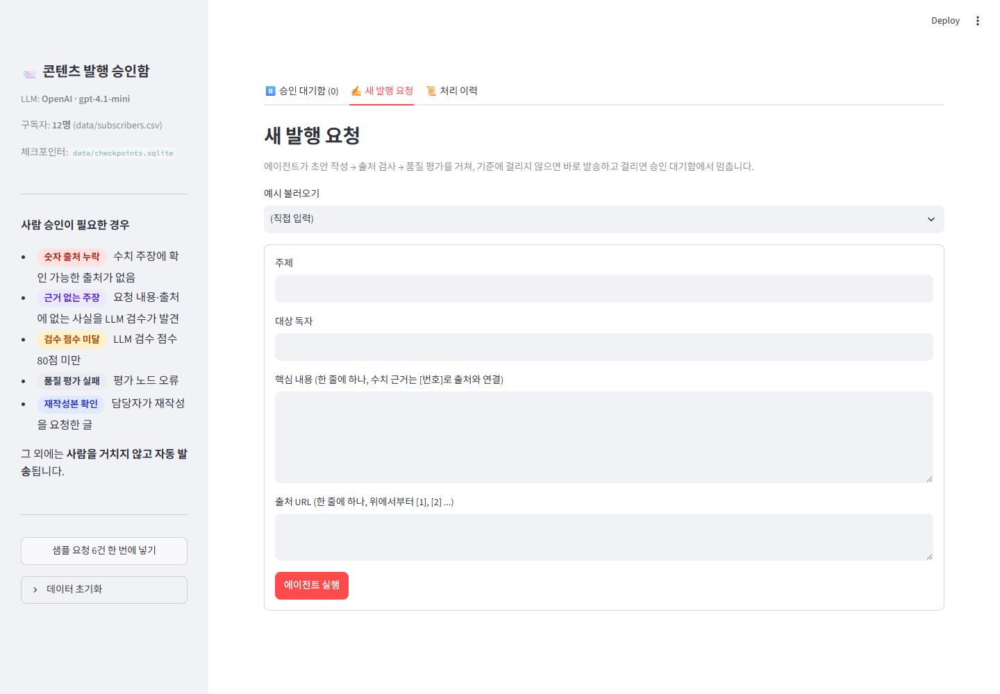

### 뺀 것과 이유

| 뺀 것 | 이유 |
|---|---|
| **일괄 승인 버튼** | 여러 건을 한 번에 승인하면 내용을 읽지 않고 누르는 습관(rubber-stamping)이 생김. 대기함에 오는 건은 모두 "위험이 있다"고 판정된 건이므로 한 건씩 보게 함 |
| **자동 발송 건을 대기함에 표시** | 대기함은 "내가 결정해야 할 것"만 보여야 함. 자동 발송 건은 처리 이력 탭에서만 확인 |
| **LLM 원본 프롬프트·JSON 응답, 체크포인트 원본 상태** | 담당자 판단에 필요 없는 개발자용 정보. 필요한 값(점수, 분류, 사유)만 사람이 읽는 형태로 바꿔 보여 줌 |
| **토큰 사용량·비용** | 승인 판단과 무관 |
| **v1 ↔ v2 diff 보기** | 넣고 싶었지만 범위상 제외. 대신 "직전 재작성 요청"을 원문 옆에 보여 줌 (회고 참고) |
| **"정말 발송할까요?" 확인 대화상자** | ④에 결과를 미리 크게 보여 주는 것으로 대신함. 버튼 두 번 누르기는 습관적으로 넘기기 쉬움 |

## 6. 프로젝트 회고

### 가장 공들인 부분
**승인 기준을 "실제로 돌려 보며" 다듬은 과정**입니다. 처음 설계한 두 기준(숫자 출처, 80점)은 키 없이 규칙으로 돌릴 때는 완벽해 보였습니다. 그런데 실제 LLM으로 돌리자 **숫자 없는 지어낸 주장이 90점으로 자동 발송**되었습니다. 기준을 더하자 이번에는 상식적인 설명까지 잡는 과잉 탐지가 생겼습니다. 결국 "주장 유형을 분류하고 위험한 유형의 *건수*로 판단한다"는 형태에 도달했습니다. 이 과정에서 배운 점은 다음과 같습니다.
- LLM이 매기는 **점수는 생각보다 후하고, 흔들립니다.** 기준은 점수 하나보다 "무엇이 몇 건"처럼 셀 수 있는 형태가 더 안정적입니다.
- 기준을 바꿀 때마다 **통과해야 할 글과 멈춰야 할 글을 함께** 다시 돌려 봐야 합니다. 한쪽만 보면 반대쪽 실수가 생깁니다.

두 번째로 공들인 부분은 **재개 경로의 정확성**입니다. "재작성 → 재검사 → 다시 사람에게"라는 순환을 만들면서, 재작성본이 자동 발송되던 정책 구멍과 이전 버전 본문이 발송되던 화면 버그를 찾아 고쳤습니다. HITL은 멈추는 것보다 **올바른 상태로 이어지는 것**이 더 어렵다는 걸 느꼈습니다.

### 앞으로 보완하고 싶은 점
- **인용 왜곡 검사:** 지금은 수치에 출처가 *연결되어 있는지*만 봅니다. 출처 페이지를 가져와 본문 수치가 실제로 그 안에 있는지 대조하는 검사를 넣고 싶습니다.
- **평가 노드의 일관성:** 같은 요청도 실행마다 판단이 달라질 수 있습니다(전기차 사례). 평가를 2~3회 돌려 다수결로 정하거나, 판단이 갈리면 사람에게 보내는 방식을 시험해 보고 싶습니다.
- **기준 튜닝 데이터:** 담당자의 승인·반려·수정 기록이 쌓이면 "사람이 그대로 승인한 건"과 "고친 건"을 비교해 80점 기준과 분류 규칙을 조정할 수 있습니다. #5에서 사람이 지운 문장처럼 평가 노드가 놓친 사례는 평가 프롬프트의 예시로 쓸 수 있습니다.
- **비교표 데이터 늘리기:** 지금 정답 데이터는 10건이라 놓침·헛멈춤이 둘 다 0이 나왔습니다. 실제 발행 요청과 담당자 결정을 정답으로 모아 수십 건 규모로 다시 비교하고, 80점 기준을 70~90점으로 바꿔 가며 세 값이 어떻게 움직이는지 보고 싶습니다.
- **화면:** v1 ↔ v2 diff 보기, 담당자 지정, 기한을 넘긴 건을 메일·메신저로 알려 주기(지금은 화면에서만 강조), 발송 예약.
- **실제 발송 연동:** `publish` 노드를 이메일 API(예: SES, Stibee)로 바꾸고, 같은 글이 두 번 나가지 않도록 `request_id` 기준의 멱등성 처리를 추가해야 합니다.
